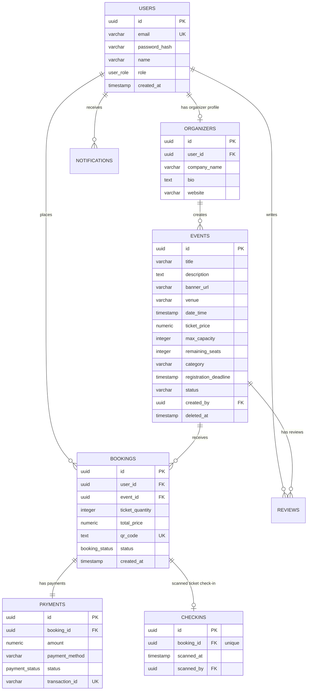

# EventHub - Production-Ready Event Ticket Booking Platform

EventHub is a modern, high-performance, full-stack event ticket booking and management platform. It represents software engineering practices tailored for production: utilizing clean OOP architecture, robust database transactions, concurrency checks to prevent overselling, role-based JWT sessions, memory caching with Redis, and containerized deployment with Docker.

---

## 🚀 Key Features

*   **Prevent Overbooking:** Ensures zero ticket overselling by using atomic PostgreSQL transactions with row-level locks (`SELECT ... FOR UPDATE`).
*   **Redis Cache Layer:** Accelerates read speeds by caching event details (`event:{id}`), public grids (`events:all`), trending recommendations (`events:trending`), search keywords, and user sessions.
*   **Role-Based Security:** Features visitor, customer, organizer, and platform admin user groups with JWT access and refresh token rotation.
*   **QR Codes:** Generates high-fidelity QR passes encoded in base64 on checkouts, supporting simulated gate check-ins with unique scan checks.
*   **Local Mocks Mode:** Automatically operates without AWS S3 or active SMTP credentials if they are absent, falling back to writing banner images to local storage and printing emails to the console.

---

## 🛠️ Technology Stack

*   **Frontend:** React.js, Vite, Axios, React Router, custom CSS3 (premium glassmorphic styling).
*   **Backend:** Node.js, Express.js (strict Object-Oriented patterns: Controllers, Services, Repositories, Models).
*   **Database:** PostgreSQL (Transactions, Indexes, Cascades).
*   **Caching:** Redis (Session storage, key invalidation, TTL).
*   **Deployment:** Docker, Docker Compose, AWS EC2, AWS S3.

---

## 🗂️ Project Directory Structure

```
ticket-organizer/
├── docker-compose.yml       # Orchestrates app containers (react, node, pg, redis)
├── init.sql                 # PostgreSQL initialization tables, indexes, and seeds
├── README.md                # General documentation
├── backend/
│   ├── src/
│   │   ├── config/          # Pool connections for DB, Redis, Multer uploader
│   │   ├── controllers/     # HTTP endpoint handlers (OOP classes)
│   │   ├── models/          # Domain entity data validation definitions
│   │   ├── repositories/    # Database queries & transactional locks (FOR UPDATE)
│   │   ├── services/        # Logic layers (caching, mailers, bookings orchestrations)
│   │   ├── middlewares/     # JWT authentication, Rate limiting, Error catchers
│   │   ├── utils/           # Utilities
│   │   ├── app.js           # Express configuration routes
│   │   └── server.js        # Server execution entry point
│   ├── Dockerfile
│   └── .env.example
├── frontend/
│   ├── src/
│   │   ├── components/      # UI components (Navbar, protected guards)
│   │   ├── context/         # React state providers (Auth, Toast)
│   │   ├── pages/           # Pages (Events discovery, dashboards, login/register)
│   │   ├── services/        # Axios API configurations and JWT token refreshes
│   │   ├── App.jsx          # Route paths mapping
│   │   └── main.jsx         # App mounting
│   ├── nginx.conf           # Fallback routing configurations for Nginx
│   ├── Dockerfile
│   └── index.html
```

---

## 📊 Entity Relationship (ER) Diagram



---

## ⚡ Setup & Execution Guide

### Prerequisite Checklist
*   **Docker & Docker Compose** installed.
*   **Node.js v20+** installed (optional, for local scripting/testing).

---

### Step 1: Start App Containers
Run the stack with a single command from the root workspace folder:
```bash
docker compose up --build
```
This builds and launches four container nodes:
1.  **PostgreSQL** (bound to host port `5433` to prevent local service clashes, internal port `5432`).
2.  **Redis** (bound to port `6379`).
3.  **Backend Express API** (bound to port `5000`).
4.  **Frontend Nginx Server** (bound to port `3000`).

---

### Step 2: Open the Web Portal
Once started, visit:
👉 **[http://localhost:3000](http://localhost:3000)**

#### Pre-seeded Evaluation Accounts (Password: `password123`):
*   **Administrator User:** `admin@eventhub.com`
*   **Organizer User:** `organizer@eventhub.com`
*   **Customer User:** `customer@eventhub.com`

---

## 🧪 Running Concurrency Tests (Prevent Overbooking)

To verify the atomic Row-Level transactional locks:
1.  Verify the PostgreSQL and Redis Docker containers are up.
2.  Navigate to the `backend/` folder and execute the concurrency script:
```bash
cd backend
npm install
npm run test:concurrency
```
This script creates a mock event with 5 seats, dispatches 10 parallel booking requests, and asserts that exactly 5 bookings succeed and 5 bookings are rejected with a "not enough seats" error.

---

## 🛰️ AWS Production Deployment

### 1. Storage: AWS S3 Configuration
1.  Create an AWS S3 Bucket (e.g. `eventhub-posters-bucket`).
2.  Configure public access policies to allow GET requests for banner objects.
3.  In `backend/.env`, update parameters:
    ```env
    S3_MOCK=false
    AWS_ACCESS_KEY_ID=your_access_key
    AWS_SECRET_ACCESS_KEY=your_secret_access_key
    AWS_REGION=us-east-1
    AWS_BUCKET_NAME=your-eventhub-posters-bucket
    ```

### 2. Computing: AWS EC2 Deployment
1.  Launch an EC2 instance (Ubuntu 22.04 LTS recommended) and associate an Elastic IP.
2.  Configure Security Group inbound rules:
    *   Port `80` (HTTP) -> Redirect traffic.
    *   Port `443` (HTTPS) -> SSL Certificates.
    *   Port `22` (SSH) -> Console access.
3.  Install Docker and Docker Compose on the virtual instance.
4.  Clone the repository code onto the server, populate `/backend/.env` with production keys, and start the compose daemon:
    ```bash
    docker compose -f docker-compose.yml up -d --build
    ```
